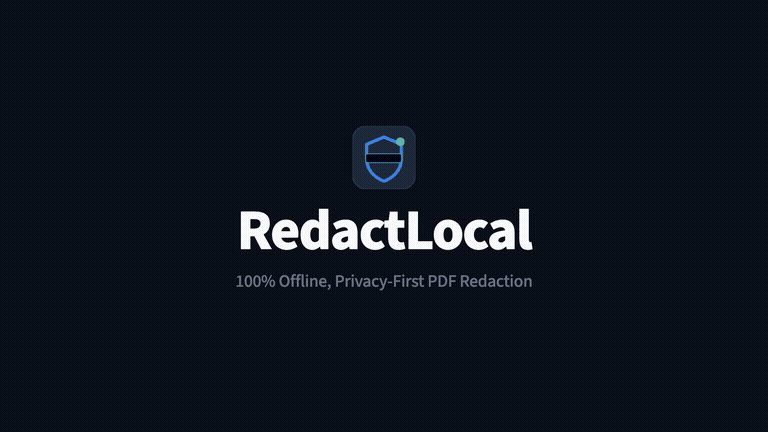

# RedactLocal

> **Privacy-First, 100% Offline PDF Surgical Redaction & Free Client-Side Leak Triage.**  
> Permanent bytecode excision of Social Security Numbers, banking details, and confidential data with zero cloud telemetry.

---

### 🌐 [Click Here to Launch the Live Web App & Free Leak Scanner](https://mohdashraf010897.github.io/redactlocal-public/)

> **Looking for the free online scanner?**  
> You can audit any "redacted" PDF right now directly inside your browser with **zero server uploads**. Powered entirely by client-side WebAssembly, your documents never leave your computer.
> 
> 🚀 **[Open Web App & Free Scanner](https://mohdashraf010897.github.io/redactlocal-public/)** &nbsp;•&nbsp; 🎬 **[Watch 38s Demo Video](https://mohdashraf010897.github.io/redactlocal-public/video-player.html)** &nbsp;•&nbsp; 🍏 **[Download macOS .dmg (7.4 MB)](https://github.com/mohdashraf010897/redactlocal-public/releases/download/v1.0.0/RedactLocal.dmg)** &nbsp;•&nbsp; 📦 **[Download macOS .pkg (7.0 MB)](https://github.com/mohdashraf010897/redactlocal-public/releases/download/v1.0.0/RedactLocal-Installer.pkg)**

---

## 🎬 Product Demo (38-Second Architecture Explainer)

Drawing black boxes in Acrobat or Preview leaves Social Security Numbers, banking codes, and form entries hidden inside raw document streams. See how RedactLocal's WebAssembly engine surgically excises raw bytecode offline:

▶️ **[Click here to watch the full 1080p demo video in browser](https://mohdashraf010897.github.io/redactlocal-public/video-player.html)** *(Or [direct MP4 download](https://mohdashraf010897.github.io/redactlocal-public/assets/redactlocal-demo.mp4))*

| Scene | Timestamp | Focus & Architectural Defense |
|---|---|---|
| **01** | `00:00` | **Air-Gap Sandbox**: Zero telemetry, zero cloud dependencies, complete offline execution. |
| **02** | `00:05` | **The Black Box Reality**: Why visual overlays fail and leak raw `/V` stream data to clipboards. |
| **03** | `00:13` | **Wasm Bytecode Engine**: Surgical character operator (`Tj`/`TJ`) and font glyph excision. |
| **04** | `00:21` | **7-Oracle Clean Room**: Independent dual parsers (PDF.js + pypdf) proving 0 leaks. |
| **05** | `00:30` | **$49 Lifetime vs $240/yr**: 1-click installer downloads and statutory court compliance. |

---

## ⚡ Free Web Triage Scanner (Zero Server Uploads)

You don't need to install anything to verify if your PDFs are leaking confidential data:  
👉 **[Launch RedactLocal Web Leak Scanner](https://mohdashraf010897.github.io/redactlocal-public/)**

- **100% Client-Side WebAssembly**: Your document is processed strictly in your browser's private memory sandbox. Zero bytes are uploaded to any server.
- **Audits 5 Critical Leak Channels**:
  1. **Metadata & Info Dictionaries**: Unwiped document authors, creation timestamps, and software stamps.
  2. **Underlying Text Streams**: Character glyphs and font operators lingering beneath visual black rectangles.
  3. **Incremental `/Prev` Revisions**: Prior unredacted revisions preserved at the end of the file.
  4. **AcroForm `/Widget` Values**: Interactive form field `/V` entries (SSNs, EINs, account numbers).
  5. **XFA XML Datasets**: Interactive XML packets bundled into government, court, and IRS filings.
- **Progressive Web App (PWA)**: Works offline in airplane mode once loaded.

---

## 📥 Downloads (v1.0.0 Stable)

Download the native, 100% offline desktop application:

| Platform | Format | Size | Checksum / Link |
|---|---|---|---|
| **macOS (Apple Silicon & Intel)** | Disk Image (`.dmg`) | 7.4 MB | [🍏 **Download RedactLocal.dmg**](https://github.com/mohdashraf010897/redactlocal-public/releases/download/v1.0.0/RedactLocal.dmg) |
| **macOS (Apple Silicon & Intel)** | Installer (`.pkg`) | 7.0 MB | [📦 **Download RedactLocal-Installer.pkg**](https://github.com/mohdashraf010897/redactlocal-public/releases/download/v1.0.0/RedactLocal-Installer.pkg) |
| **Web / Air-Gapped Browser** | PWA Web App | Instant | [🌐 **Launch Live Web App**](https://mohdashraf010897.github.io/redactlocal-public/) |
| **Windows 10 / 11** | Installer (`.msi` / `.exe`) | Automated CI | [🪟 **Windows Build Workflow**](https://github.com/mohdashraf010897/redactlocal-public/actions/workflows/build-windows.yml) |

> [!important] **First-time macOS Launch Note (Apple Gatekeeper)**  
> When opening `RedactLocal.dmg` on macOS Sequoia / Sonoma, macOS may show an alert:  
> `“RedactLocal.dmg” Not Opened — Apple could not verify “RedactLocal.dmg” is free of malware...`  
> 
> **Why this appears:** RedactLocal is an open-source air-gapped utility built with 100% offline privacy (zero remote phone-homes and no Apple cloud notary telemetry). Apple flags all third-party software downloaded from web browsers until approved.  
> 
> **To open in 3 seconds:**  
> 1. Click **Done** on the alert (do NOT click *Move to Bin*).  
> 2. Open **System Settings → Privacy & Security** and scroll down to the **Security** section.  
> 3. Click **"Open Anyway"** and confirm with your password or Touch ID.  
> 
> *(Or clear the browser download quarantine flag in Terminal with: `xattr -d com.apple.quarantine ~/Downloads/RedactLocal*.dmg`)*  
> *Alternative: Double-click `RedactLocal-Installer.pkg` to install directly to `/Applications`.*

---

## 🏷️ Plans & Pricing: Free Online Triage vs. Founders Lifetime Pass

| Capability / Feature | Free Online Triage ($0 Forever) | Founders Lifetime Pass ($39 Early / $49) |
|---|---|---|
| **Execution Environment** | Client-Side WebAssembly (In-Browser) | **100% Air-Gapped Native Desktop App** (macOS & Windows) |
| **Network & Privacy** | **0 bytes uploaded** (Private browser sandbox) | **0 bytes uploaded** (Zero network permissions `connect-src 'none'`) |
| **Forensic Leak Audit** | ✅ 5 attack surfaces (Text, `/V`, `/Prev`, Meta, XFA) | ✅ Full 7-Oracle forensic engine |
| **Surgical Redaction** | ⚠️ Single-file testing preview | ✅ **Unlimited permanent bytecode eradication** |
| **Batch Queue Processing** | ❌ Single document only | ✅ **Drag & drop 100+ documents in parallel** |
| **Bulk ZIP Export** | ❌ None | ✅ **1-Click high-speed sanitized ZIP download** |
| **Court Compliance Ledger** | ❌ None | ✅ **Sworn FRCP 5.2 & HIPAA CSV Ledger** (Input/Output SHA-256) |
| **Scanned Pixel Burnout** | ❌ None | ✅ **Destroys underlying raster pixels on scanned documents** |
| **License Terms** | Free Web Tool | **Perpetual offline Ed25519 digital license (.rlkey)** |
| **Pricing** | **$0** (Free forever) | **$39 one-time** (Early launch discount · $0 subscriptions forever) |

👉 **[Try the Free Web Scanner](https://mohdashraf010897.github.io/redactlocal-public/)** &nbsp;|&nbsp; 👉 **[Pre-Order $39 Founders Pass](https://mohdashraf010897.github.io/redactlocal-public/#plans)**

---

## ⚖️ RedactLocal vs. Adobe Acrobat Pro

| Feature / Requirement | RedactLocal Desktop | Adobe Acrobat Pro |
|---|---|---|
| **Pricing Model** | **$49 One-Time Lifetime** ($39 Early Pass) | $239.88 / year recurring subscription |
| **Cloud & Telemetry Risk** | **0 bytes sent**. Air-gapped verified. | Syncs documents to Adobe Document Cloud |
| **Redaction Eradication** | **True bytecode stream operator excision** | Visual overlay (leaves XFA/metadata if unconfigured) |
| **Court Verification Receipt** | **Official Cryptographic Receipt** (SHA-256) | None. No independent oracle audit. |
| **Statutory Compliance** | **FRCP 5.2, HIPAA Safe Harbor, IRS § 7216** | Requires complex enterprise BAA configuration |

---

## 🛡️ Statutory Compliance Guarantees

RedactLocal is engineered to satisfy strict federal and statutory data protection rules:
- **FRCP Rule 5.2**: Privacy Protection For Filings Made with the Court (Social Security Numbers, taxpayer IDs, financial account numbers, dates of birth, minor children names).
- **HIPAA Safe Harbor (§ 164.514)**: Complete excision of 18 statutory Protected Health Information (PHI) identifiers.
- **Fail-Closed Eradication**: Bytecode operator deletion rather than visual overlay blackouts.

---

## 📚 Policies & Support

- [Privacy Policy](PRIVACY.md) — Strict zero-telemetry and zero-data-collection commitment.
- [Terms of Service](TERMS.md) — Perpetual offline license terms and compliance warranties.
- [Support Guide](SUPPORT.md) — Frequently asked questions and issue reporting.
- [Security Policy](SECURITY.md) — Vulnerability disclosure guidelines.

---

## Author & Maintainer

Created and maintained by **Mohd Ashraf** ([@mohdashraf010897](https://github.com/mohdashraf010897)).  
Feedback and feature requests are welcome via [GitHub Issues](https://github.com/mohdashraf010897/redactlocal-public/issues).
